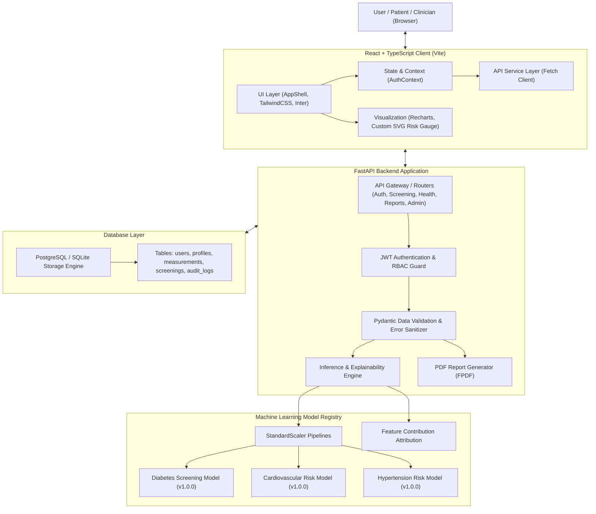
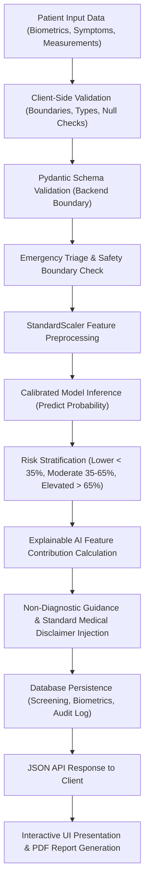
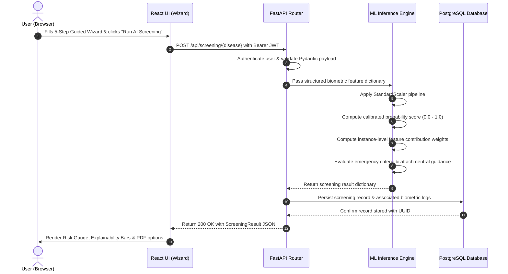

# HealthAI — System Architecture

**HealthAI** is a modern, modular AI health screening web application designed for early statistical risk detection and longitudinal biometric tracking.

---

## 1. High-Level System Architecture

---

## 2. End-to-End Screening Data Flow

---

## 3. Screening Request Sequence Diagram

---

## 4. Architectural Principles

1. **Strict Medical Safety Separation**:
   - The platform strictly distinguishes **statistical health screening** from **medical diagnosis**.
   - No diagnostic pronouncements are ever generated ("You have diabetes" is replaced by "Elevated diabetes risk detected").
   - Every inference response contains the standard, non-removable disclaimer.
2. **Modular Screening Extensibility**:
   - Adding a new disease module requires zero modifications to the core API architecture. Each module exposes a uniform contract: preprocessing pipeline, metadata, model weights, and threshold bounds.
3. **In-Memory Model Serving**:
   - Machine learning pipelines are loaded into memory once during application startup and cached for microsecond-latency inference.
4. **Data Privacy by Design**:
   - Administrative dashboards present only aggregate metrics (volume, stratification, model benchmarks) without exposing individual patient protected health information (PHI).
