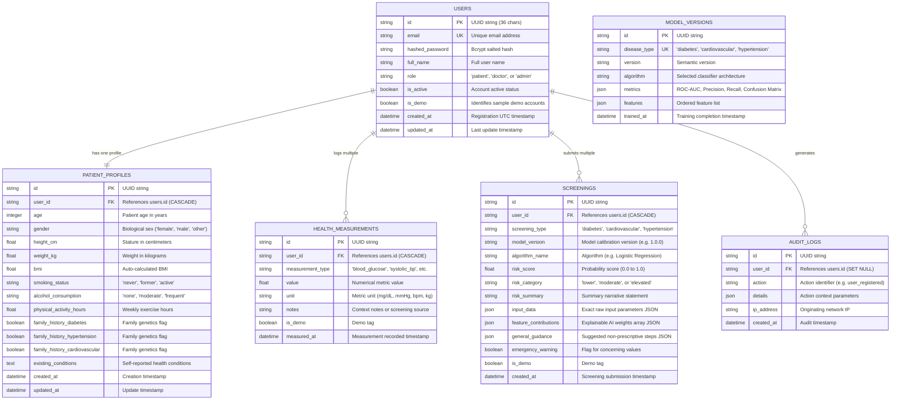

# HealthAI — Database Schema & Data Dictionary

HealthAI employs a relational relational database architecture (compatible with both PostgreSQL and SQLite for zero-dependency local runs).

---

## 1. Entity-Relationship (ER) Diagram

---

## 2. Table Indexing & Performance Design
- `users`: Indexed on `email` (unique) and `id` (primary key).
- `screenings`: Indexed on `user_id` and `created_at` for rapid screening history paging.
- `health_measurements`: Composite index on `(user_id, measurement_type, measured_at)` for high-throughput trend calculations.
- `patient_profiles`: Unique index on `user_id`.
